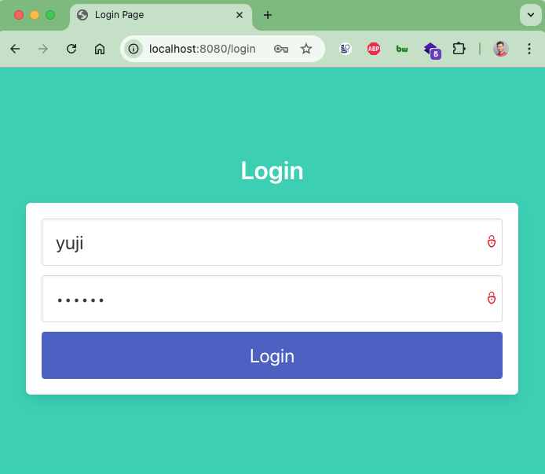
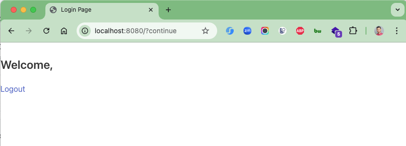

# spring-boot-multi-authenticate

[](https://github.com/hendisantika/spring-boot-multi-authenticate/actions/workflows/gradle.yml)


Example demo of **multiple authentication mechanisms** in a single application with Spring Boot 4 and Spring Security 7.
Each mechanism lives in its own ordered `SecurityFilterChain`:

| Order | Paths                             | Mechanism                                                  | Config class                   |
|-------|-----------------------------------|------------------------------------------------------------|--------------------------------|
| 1     | `/api/internal/**`                | API key in `x-api-key` header (plain servlet filter)       | `config/SpringSecurityConfig`  |
| 2     | `/public/**`, `/protected/**`     | API key in `ApiKey` header (stateless `Authentication`)    | `config/sample2/SecurityConfiguration` |
| 3     | everything else                   | Form login (session based, in-memory user)                 | `config/SpringSecurityConfig`  |

## Tech Stack

- Java 25
- Spring Boot 4.1.1 (Spring Security 7, Jackson 3)
- Jetty (instead of Tomcat)
- Pebble template engine
- Lombok
- Gradle 9.8.2 (wrapper included)

## Requirements

- JDK 25 (the Gradle toolchain is pinned to Java 25)

## Things to do list

1. Clone this repository: `git clone https://github.com/hendisantika/spring-boot-multi-authenticate.git`
2. Navigate to the folder: `cd spring-boot-multi-authenticate`
3. Run the application: `./gradlew bootRun`
4. Open your favorite browser: http://localhost:8080

Build & run the tests: `./gradlew build`

## Information to demo

- Username: `yuji`
- Password: `53cret`
- API key: `jujutsu.kaisen`

The API keys are configured in `src/main/resources/application.properties`:

```properties
# used by /api/internal/** (x-api-key header)
internal.api-key=jujutsu.kaisen
# used by /protected/** (ApiKey header), can be overridden with the API_KEY env variable
application.security.api-key=${API_KEY:jujutsu.kaisen}
```

## 1. Internal API (`x-api-key` header)

Without API key:

```shell
curl -i http://localhost:8080/api/internal/health
```

```json
HTTP/1.1 401 Unauthorized

{
  "message": "SC_UNAUTHORIZED"
}
```

With API key:

```shell
curl --location 'http://localhost:8080/api/internal/health' \
--header 'x-api-key: jujutsu.kaisen'
```

## 2. Public & protected greetings (`ApiKey` header)

Public endpoint, no authentication needed:

```shell
curl http://localhost:8080/public/greetings
# Greetings from a public endpoint!
```

Protected endpoint without API key returns `401 Unauthorized`:

```shell
curl -i http://localhost:8080/protected/greetings
```

Protected endpoint with API key:

```shell
curl http://localhost:8080/protected/greetings \
--header 'ApiKey: jujutsu.kaisen'
# Greetings from a protected endpoint!
```

## 3. Web application (form login)

Any other URL redirects to `/login`. Sign in with `yuji` / `53cret` to reach the home page.

## CI/CD & Dependency Updates

- **GitHub Actions** (`.github/workflows/gradle.yml`) builds and tests the project on JDK 25 (Temurin) for every
  push and pull request to `main`, and submits the dependency graph for Dependabot alerts.
- **Dependabot** (`.github/dependabot.yml`) checks Gradle dependencies and GitHub Actions daily at 05:00 Asia/Jakarta.
  Minor/patch updates are grouped (Spring, test libraries, other Gradle deps, GitHub Actions) and use conventional
  commit messages (`build(deps)`, `ci(deps)`).

## Image Screenshots

Login Page



Home Page


